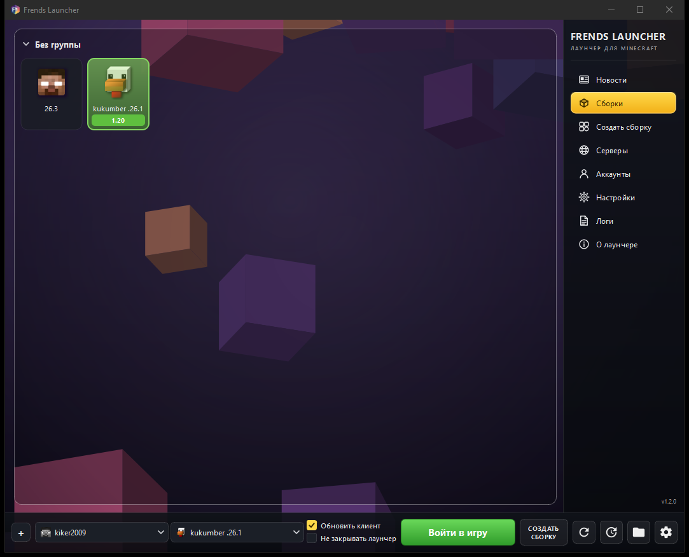
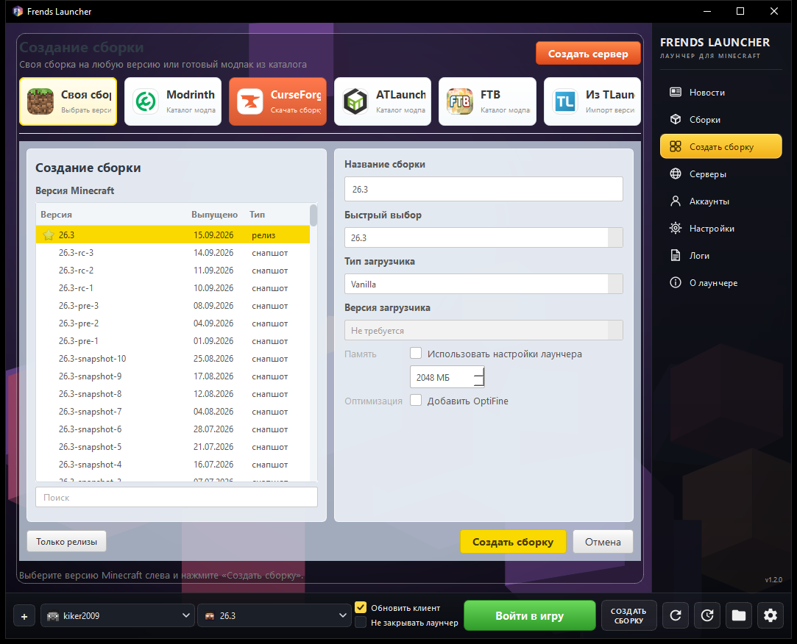
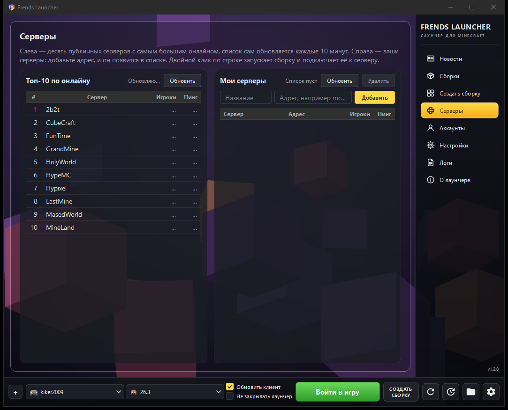

<p align="center">
<picture>
  <source media="(prefers-color-scheme: dark)" srcset="/program_info/org.frends.FrendsLauncher.logo-darkmode.svg">
  <source media="(prefers-color-scheme: light)" srcset="/program_info/org.frends.FrendsLauncher.logo.svg">
  
</picture>
</p>

<h1 align="center">Frends Launcher</h1>

<p align="center">
  Лаунчер Minecraft с офлайн-аккаунтами, сборками в пару кликов и своим сервером.<br />
  Без навязчивого софта, без рекламы, без регистрации.
</p>

<p align="center">
  <b>Версия 1.2.0</b> · Windows x64 · GPL-3.0-only
</p>

## Скачать

| | Файл | Размер | Что это |
|---|---|---|---|
| **Установщик** | `FrendsLauncher-1.2-setup.exe` — [страница релиза](https://github.com/KAKTYS200/FrendsLauncher/releases/latest) | ~32 МБ | Ставится в `Program Files`, добавляет ярлык в меню «Пуск» и удаляется из «Программ и компонентов» |
| **Портативная** | [FrendsLauncher-portable.zip](https://github.com/KAKTYS200/FrendsLauncher/releases/latest/download/FrendsLauncher-portable.zip) | ~41 МБ | Распаковать в любую папку и запустить `frendslauncher.exe`, установка не нужна |

**Требования:** Windows 10/11 x64. Java искать не обязательно — лаунчер сам скачивает нужную версию при первом запуске, а если Java уже установлена, использует её.

Все версии и списки изменений — в разделе [Releases](https://github.com/KAKTYS200/FrendsLauncher/releases).

## Скриншоты

<p align="center">
  
</p>

<p align="center">
  
  
</p>

## Возможности

- **Офлайн-аккаунты** — добавьте любой ник без лицензии Microsoft и играйте.
- **Сборки в пару кликов** — версия игры, загрузчик (Vanilla, Forge, NeoForge, Fabric, Quilt, LiteLoader), имя подставляется само.
- **Каталоги модпаков** — Modrinth, CurseForge, ATLauncher и FTB прямо на странице создания сборки.
- **Импорт из TLauncher** — укажите папку `versions`, и лаунчер сам разберёт сборки: определит версию игры и загрузчик, пересоздаст сборку на официальных метаданных и перенесёт моды, конфиги и сохранения.
- **Свой сервер** — кнопка «Создать сервер»: выбираете версию и ядро (Mojang или Paper), лаунчер скачивает ядро, пишет `eula.txt` и запускает сервер с консолью в окне.
- **Список серверов** — топ публичных серверов по онлайну с живым пингом и свои адреса. Двойной клик запускает сборку сразу на нужный сервер.
- **Мультиплеер на офлайн-аккаунте** — лаунчер поднимает локальный сервер сессий, поэтому ванильный клиент пускает в игру без ошибки «Invalid session».
- **Обновление в один клик** — кнопка в нижней панели сама спрашивает у GitHub последний релиз, скачивает архив и перезапускается уже новой версией.
- **Своё оформление** — процедурный фон, палитра, свой фон-картинка и масштаб интерфейса 80–150 %.
- **Приватность** — лаунчер не отправляет статистику и не собирает идентификаторы.

## Быстрый старт

1. **Аккаунт.** Раздел «Аккаунты» → «Добавить аккаунт» → вкладка офлайн-аккаунта → введите ник. Лицензия Microsoft не нужна.
2. **Сборка.** «Создать сборку» → выберите версию Minecraft и загрузчик → «Создать сборку». Или импортируйте готовые сборки из TLauncher.
3. **Играть.** Выберите сборку в нижней панели и нажмите «Войти в игру».

### Нижняя панель

Слева направо: аккаунт, сборка, две галочки, кнопка запуска, кнопки «Создать сборку», «Обновить список», «Обновить лаунчер», «Открыть папку сборки», «Настройки».

- **Обновить клиент** — перед запуском проверить и докачать файлы сборки (библиотеки, ресурсы). Включено по умолчанию: без этого Minecraft иногда падает с «missing libraries».
- **Не закрывать лаунчер** — окно останется открытым после старта игры. По умолчанию лаунчер сворачивается и возвращается, когда игра закрыта.
- **Войти в игру / Остановить** — кнопка меняется сразу после нажатия, ещё во время скачивания и распаковки. Повторное нажатие прерывает подготовку или закрывает игру.

## Что нового в 1.2

- **«Остановить» с первого мгновения.** Раньше кнопка переключалась только после старта JVM, и всё время проверки и скачивания файлов прервать запуск было нечем.
- **Галочка «Обновить клиент» с настоящей отметкой** — раньше это был жёлтый квадрат без галочки.
- **Переключатель «Не закрывать лаунчер»** — окно остаётся открытым после запуска игры.

Полный список изменений по версиям — в [Releases](https://github.com/KAKTYS200/FrendsLauncher/releases) и [CHANGELOG.md](CHANGELOG.md).

## Устройство проекта

Frends Launcher — форк [Prism Launcher](https://github.com/PrismLauncher/PrismLauncher) 11.1.1 (который, в свою очередь, форк MultiMC). Ядро лаунчера осталось призмовским, переписаны интерфейс и часть игровой логики.

Свои файлы лежат отдельно, чтобы не смешиваться с апстримом:

| Путь | Что там |
|---|---|
| `launcher/ui/frends/` | Всё оформление: фон, боковая панель, нижняя панель, страницы создания сборки и серверов, масштабирование, палитра |
| `launcher/frendskin/` | Система скинов (сейчас отключена, см. ниже) |
| `launcher/frendsession/` | Локальный сервер сессий для офлайн-аккаунтов (мультиплеер) |
| `launcher/FrendsSelfUpdate.*` | Обновление лаунчера через релизы GitHub |
| `launcher/TLauncherImportTask.*` | Разбор и импорт сборок из TLauncher |
| `launcher/ui/pages/modplatform/TLauncherPage.*` | Страница импорта из TLauncher |
| `docs/` | Заметки по устройству: интерфейс, система скинов |

### Скины отключены

Система скинов для офлайн-аккаунтов в репозитории есть (`launcher/frendskin/`, описание — [docs/frend-skin.md](docs/frend-skin.md)), но **выключена**: `FrendSkins::ENABLED = false` в `launcher/frendskin/FrendSkinServer.h`. Сервер скинов не создаётся, привязки не читаются, свойство `textures` клиенту не передаётся. Чтобы включить обратно, достаточно поставить `true` — остальной код на месте.

### Обновление лаунчера

Кнопка обновления не использует манифест: она читает `releases/latest` через GitHub API, сравнивает тег с версией сборки (численно, поэтому `1.10` не считается старее `1.9`) и берёт из ассетов `.zip` (приоритет — имя с `portable`). Архив скачивается в `%TEMP%/frends-update-<тег>/`, распаковывается, и оттуда запускается новый `frendslauncher.exe`, который копирует себя поверх старого и перезапускает лаунчер.

Поэтому для выпуска обновления достаточно опубликовать релиз с тегом вида `v1.3` и приложить к нему zip — отдельный манифест не нужен.

### Импорт из TLauncher

TLauncher хранит каждую версию одним плоским JSON без `inheritsFrom`, поэтому базовая версия и загрузчик восстанавливаются по содержимому:

- NeoForge — по аргументам запуска `--fml.neoForgeVersion` и `--fml.mcVersion`;
- Forge — по библиотекам `net.minecraftforge:forge:<версия>-<загрузчик>` и `fmlloader`;
- Fabric — по `net.fabricmc:intermediary` и `fabric-loader`;
- Quilt — по `org.quiltmc:quilt-loader`;
- OptiFine — по артефакту `optifine:OptiFine:<версия>_HD_U_…`;
- если ничего не нашлось — по номеру версии в названии папки с проверкой по официальному манифесту.

Сборка не копируется набором jar-файлов: создаётся обычный инстанс из официальных метаданных, поэтому дальше он обновляется и запускается как любой другой. Переносится содержимое: `mods`, `config`, `defaultconfigs`, `resourcepacks`, `shaderpacks`, `saves`, `options.txt`, `optionsof.txt`, `optionsshaders.txt`, `servers.dat`, `usercache.json`. Библиотеки и jar скачиваются заново.

### Приватность

Оригинальный лаунчер отправляет сведения об окружении и два стабильных идентификатора на свои статистические домены. Frends Launcher не отправляет ничего: отчёт об окружении (`launcher/ui/frends/FrendsDiagnostics.*`) собирается локально, раздел «Приватность» в настройках позволяет его посмотреть, скопировать и сбросить идентификатор установки.

## Сборка из исходников

Окружение: **MSYS2 UCRT64 + Qt6**, CMake, компилятор MinGW. Общие инструкции Prism Launcher — [build instructions](https://prismlauncher.org/wiki/development/build-instructions).

```bash
cmake -S . -B build -G Ninja -DCMAKE_BUILD_TYPE=Release
cmake --build build --parallel 4
```

Готовый бинарник — `build/frendslauncher.exe`. Собирать нужно **Release**: в Debug срабатывает `ASSERT` из `launcher/tasks/Task.cpp`.

Версия лаунчера задаётся в одном месте — `CMakeLists.txt`, блок `######## Set version numbers ########` (`Launcher_VERSION_MAJOR/MINOR/PATCH`). Проверить результат: `frendslauncher.exe --version`.

Если путь к проекту содержит не-ASCII символы, `moc` может не найти файлы — соберите через каталог с ASCII-путём.

### Сборка с ограничением нагрузки на ЦП

В `CMakePresets.json` у пресетов `linux`, `windows_mingw` и `windows_msvc` задано `"jobs": 4`, поэтому `cmake --build --preset windows_msvc` по умолчанию использует 4 параллельных задачи.

Скрипт-обёртка `scripts/build-lowcpu.ps1` настраивает проект (если нужно) и собирает с ограничением потоков:

```powershell
# 4 потока по умолчанию
.\scripts\build-lowcpu.ps1

# 2 потока, конкретный пресет и конфигурация
.\scripts\build-lowcpu.ps1 -Jobs 2 -Preset windows_msvc -Config Release

# дополнительно добавить папку сборки в исключения Windows Defender
# (нужны права администратора)
.\scripts\build-lowcpu.ps1 -Jobs 4 -AddDefenderExclusion
```

### Дистрибутив и установщик

```bash
# 1. Скопировать exe в папку дистрибутива и подтянуть библиотеки Qt
cp build/frendslauncher.exe dist/FrendsLauncher/
windeployqt --release --no-translations --no-system-d3d-compiler --no-opengl-sw \
    dist/FrendsLauncher/frendslauncher.exe

# 2. Портативный архив — обязательно 7-Zip, не Compress-Archive
cd dist/FrendsLauncher
7z a -tzip -mcu=off -mx=9 ../FrendsLauncher-portable.zip *

# 3. Установщик (Inno Setup 6)
ISCC.exe installer/frends.iss
```

Два правила, без которых ломается обновление:

- **Архив собирать 7-Zip с `-mcu=off`.** `Compress-Archive` ставит флаг UTF-8, а распаковщик внутри лаунчера читает такие имена как CP437 — русские имена файлов превращаются в кракозябры.
- **В `dist/FrendsLauncher` не должно быть не-ASCII имён.** Файл справки поэтому называется `README.txt`, а не «Прочти меня.txt».

## Документация

- [docs/frends-ui.md](docs/frends-ui.md) — разбор интерфейса: палитра, метрики, экраны, что и откуда взято.
- [docs/frend-skin.md](docs/frend-skin.md) — как устроена система скинов для офлайн-аккаунтов (сейчас отключена).

## Благодарности

Проект стоит на плечах [Prism Launcher](https://github.com/PrismLauncher/PrismLauncher) и [MultiMC](https://github.com/MultiMC/Launcher), распространяемых под GPL-3.0. Спасибо их командам и контрибьюторам.

Frends Launcher **не связан** с Prism Launcher, MultiMC, Mojang и TLauncher и не поддерживается ими.

## Сообщить о проблеме

Нашли баг или хотите предложить идею — создайте [issue](https://github.com/KAKTYS200/FrendsLauncher/issues). Пожалуйста, приложите версию лаунчера (она видна в правом нижнем углу окна) и последние строки из раздела «Логи».

## Forking / Redistributing / Custom builds policy

You are free to fork, redistribute and provide custom builds as long as you follow the terms of the [license](LICENSE) (this is a legal responsibility), and if you made code changes rather than just packaging a custom build, please do the following as a basic courtesy:

- Make it clear that your fork is not Prism Launcher and is not endorsed by or affiliated with the Prism Launcher project (<https://prismlauncher.org>).
- Go through [CMakeLists.txt](CMakeLists.txt) and change Prism Launcher's API keys to your own or set them to empty strings (`""`) to disable them (this way the program will still compile but the functionality requiring those keys will be disabled).

If you have any questions or want any clarification on the above conditions please make an issue and ask us.

If you are just building Prism Launcher for your distribution, please make sure to set the `Launcher_BUILD_PLATFORM` to a slug representing your distribution. Examples are `archlinux`, `fedora` and `nixpkgs`.

Note that if you build this software without removing the provided API keys in [CMakeLists.txt](CMakeLists.txt) you are accepting the following terms and conditions:

- [Microsoft Identity Platform Terms of Use](https://docs.microsoft.com/en-us/legal/microsoft-identity-platform/terms-of-use)
- [CurseForge 3rd Party API Terms and Conditions](https://support.curseforge.com/en/support/solutions/articles/9000207405-curse-forge-3rd-party-api-terms-and-conditions)

If you do not agree with these terms and conditions, then remove the associated API keys from the [CMakeLists.txt](CMakeLists.txt) file by setting them to an empty string (`""`).

## Лицензия

Код лаунчера распространяется под **GPL-3.0-only** — полный текст в [COPYING.md](COPYING.md).

Логотип и связанные с ним материалы — под **CC BY-SA 4.0**.
